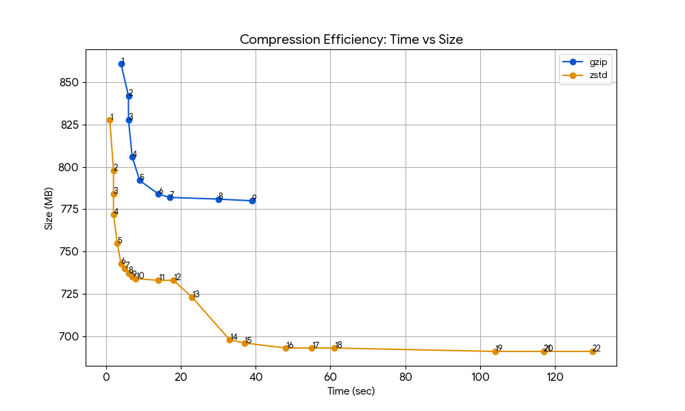

## MEMO

### Apptainer

[Apptainer repo](https://github.com/apptainer/apptainer)

### Compression method for squashfs overlays

- Use `zstd` compression level 8 for best speed/size tradeoff for squashfs overlays.
  - (Use `--lz4` for faster reading speed, but much larger file size, about 2x)
  - `--gzip` is also supported, but not recommended.
- zstd has better compression ratio and IO speed than gzip.

Cellranger 9.0.1 is used to benchmark various compression methods for squashfs.

- gzip 1-9 and zstd 1-22 were tested.
- folder size (2.4 GB)
- the results can be found in [squash_bench.csv](squash/squash_bench.csv)

### Freeze: which route to read and pack an overlay

- **Ident reads the `.sqf`, not the `.img`.** squashfuse is ~3x cheaper than
  fuse2fs for the same walk. So the pack runs first and the identity is taken
  from the finished archive.
- **Pack is superlinear (~N^1.85), ident is linear.** 30k files pack in 45.8s, 5k
  in 1.9s.
- **rdump + native pack is ~2x faster than packing through fuse2fs** at every
  tier past 1k. Costs staging space equal to the payload. Today it only runs when
  `--fusemount` cannot mount (`--use-tmp`).
- **Pack times depend on `-processors`**, so both CSVs record the value used and
  runs at different values are not comparable.

Benchmarked with [freeze_bench.sh](freeze/freeze_bench.sh) at 1k–30k files, 4 KB each,
zstd-8, 4 processors, on local disk. Results in [pack_bench.csv](freeze/pack_bench.csv)
and [ident_bench.csv](freeze/ident_bench.csv).

| at 30k files | pack | ident | total |
|---|---|---|---|
| fuse pack, ident from `.img` | 45.8s | 10.7s | 56.5s |
| fuse pack, ident from `.sqf` | 45.8s | 3.5s | 49.3s (ships) |
| rdump pack, ident from staging | 23.5s | 1.6s | **25.1s** |

### `apt install` under `--fakeroot` failing with permission denied

Without a `/etc/subuid` entry, `--fakeroot` can only map uid 0. A file the image ships owned by
any other real uid (`_apt`, from a `docker://` layer) has no mapping at all, so `apt` operating on
it fails: `rm: cannot remove '.../partial/*.deb': Permission denied`.

Fixed at the pack, not the mapping: a definition build now always goes sandbox → `mksquashfs -all-root`. 
All files in the resulting `.sqf` is owned by root, so there is no uid left for a missing subuid 
range to matter to. 

Details, the diagnostic that found it, and how to verify a given `.sqf` directly: [base-format/README.md](base-format/README.md).
