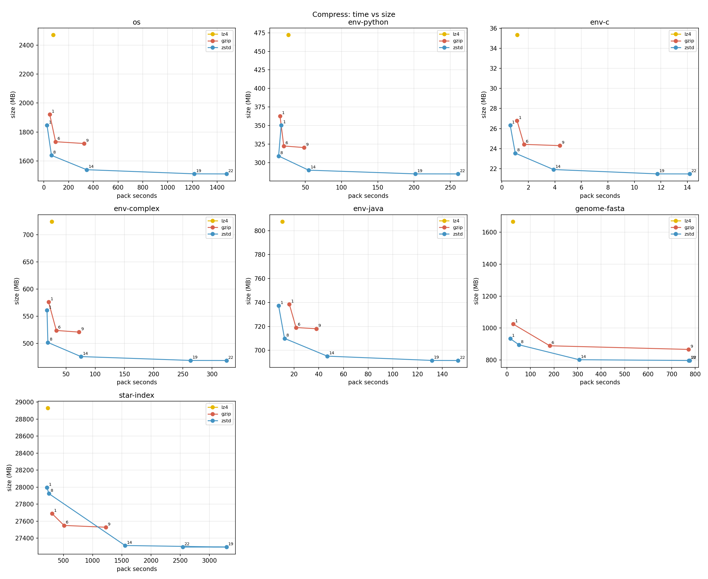
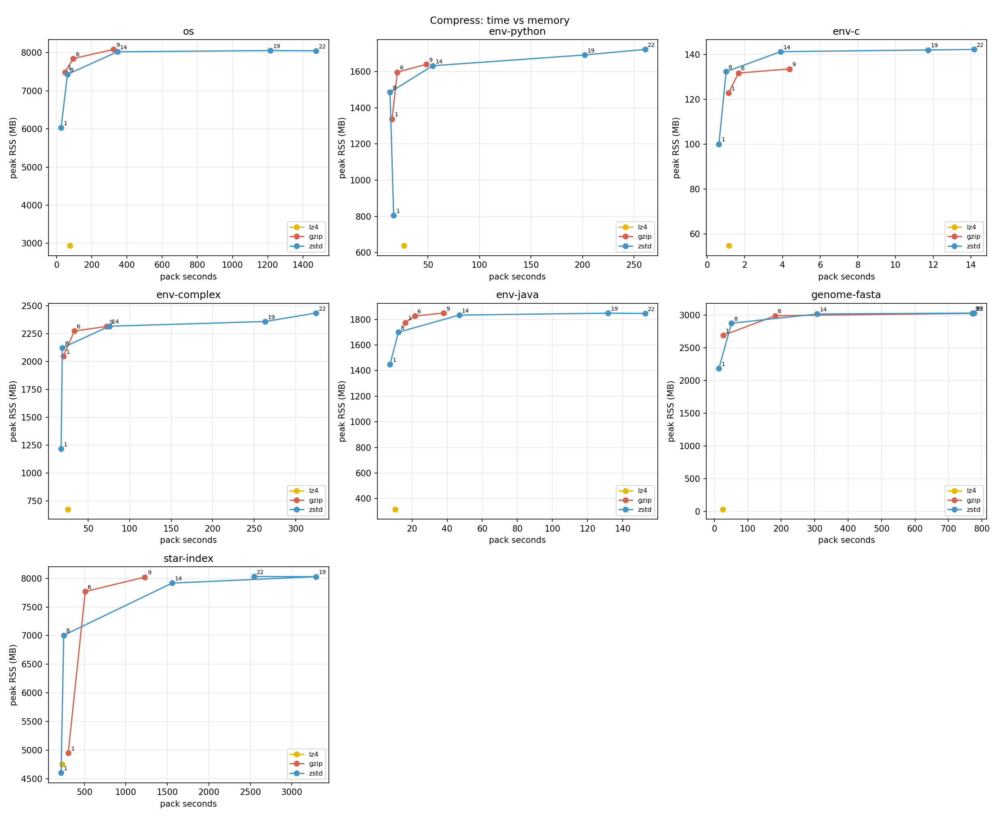
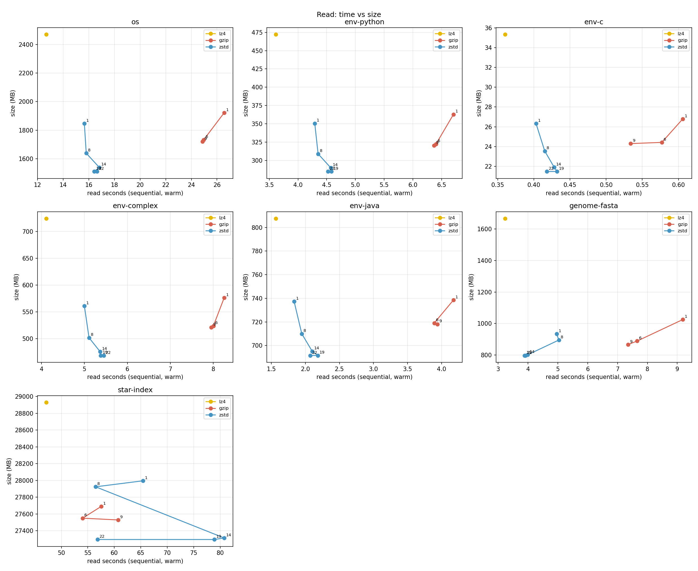
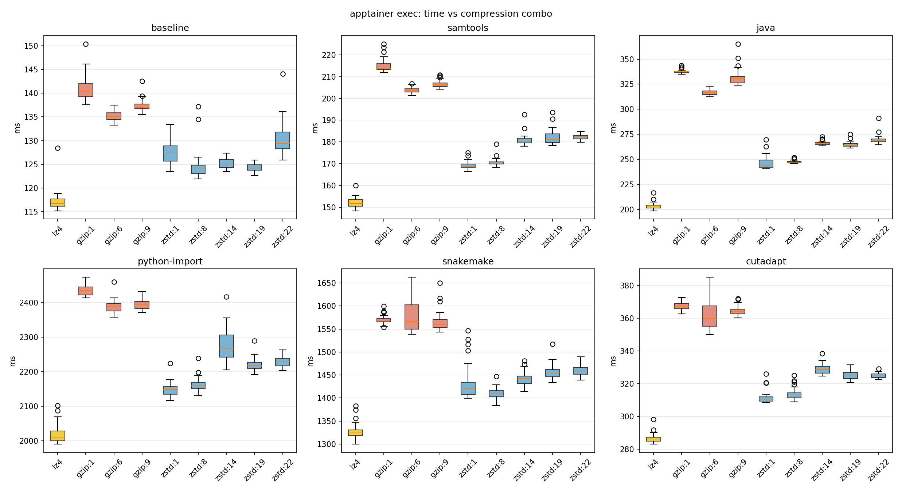
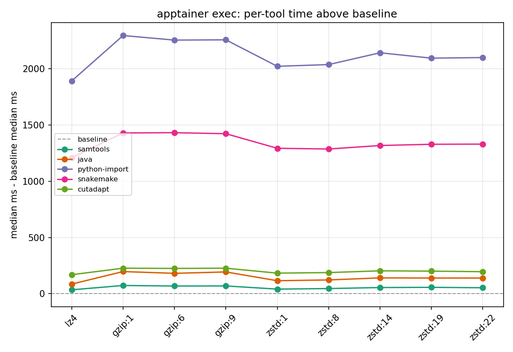

# Compress: compression ratio, memory, and read-speed benchmark

`compress_bench.sh` packs one or more real datasets at several compression
algorithms/levels, then reads the result back — sequential, random (for a
dataset with a real coordinate-indexed access pattern), and `--exec` (for a
dataset that's a program, not data). See the script's own header for the
full flag reference; `compress_matrix.sh` drives it across a fixed set of
real, already-installed datasets on this machine. `plot.py` renders its
output, one subplot per dataset, one line per algo with points labelled by
level (`lz4` has no level, so it's a lone marker):

*Pack time vs resulting archive size.* A lower/further-left point is
strictly better. This is the ratio-vs-speed trade-off behind the
level-1-vs-8-vs-14 numbers below — `zstd`'s points bend down (smaller) as
level rises while `lz4`'s single point sits furthest right (fastest) but
highest (largest).

*Pack time vs the packing process's own peak RSS.* Higher compression
levels cost memory as well as time — this is what shows the pack-time
"cliff" past level 8 also comes with a memory cost, not just a slower build.

*Sequential warm-read time vs archive size, after mounting with
`squashfuse_ll`.* Smaller archives read back faster too — compression isn't
purely a size-vs-pack-time trade, it affects read latency in the same
direction as size.

## Real `apptainer exec`: algorithm matters

`apptainer-exec-algo-compare.sh` packs one `.sqf` per combo from a sandbox
(`apptainer-exec-algo.def`: samtools, java, numpy/pandas/sklearn, snakemake,
cutadapt) and runs `apptainer exec` directly against each — no `--overlay`,
the packed `.sqf` is the whole container. 30 runs per combo/tool, raw rows
in `apptainer_exec_runs.csv`:

*One box per combo per tool, run times in ms, colored by algorithm.* Shows
the distribution (median, spread, outliers) of 30 real `apptainer exec`
runs, and that every tool's boxes shift together as combo changes, `lz4`
consistently lowest and `gzip:1` consistently highest.

A `baseline` tool (`true`, no work once inside) isolates apptainer's own
mount+exec overhead from each tool's own cost:

*Each tool's median time minus that combo's baseline median, all tools on
one axes.* All five lines trace the same up-and-down shape across combos —
that shape is `baseline`'s own algorithm sensitivity riding through every
tool — while their vertical separation is each tool's own added cost:
~2000ms for `python-import`, ~1300ms for `snakemake`, tens of ms for the
rest.

`apptainer_exec_test.py` (output in `apptainer_exec_test.out`) runs
Kruskal-Wallis across all nine combos, then pairwise Mann-Whitney against
`lz4`, to check whether what the two plots above show by eye is actually
significant:

- **`baseline` differs significantly by combo** (p=8.9e-47; ~117ms at `lz4`
  vs 124–140ms elsewhere, every combo p<1e-9 vs `lz4`) — apptainer's own
  exec path (namespace setup, image validation) is measurably
  algorithm-sensitive.
- **Subtracting that baseline out doesn't remove the effect.** Every tool's
  baseline-subtracted diff is still significant across combos (all
  p<1e-45). The residual is proportionally large for the cheap tools
  (`samtools` 35ms at `lz4` vs up to 73ms at `gzip:1`; `java` 86ms vs 197ms)
  and proportionally small for the heavy ones (`python-import` 1891ms vs
  2295ms, `snakemake` 1209ms vs 1431ms) — real in both cases, not just
  apptainer's own load time riding along.

## Conclusion

Two things matter for picking an algo/level: compression ratio and pack+exec
speed. `lz4` is fastest everywhere — every tool, every combo — but it also
has the worst ratio of any combo on every dataset in `compress_bench.csv`
(`env-python` 45.2%, `env-c` 51.4%, `star-index` 94.3% — barely compressed
at all). `gzip` loses on every axis at every level tested against the
matching `zstd` level: worse ratio, slower to pack, more pack memory. It is
never the right choice here.

`zstd`'s levels trade ratio for pack time, and the trade stops paying off
past level 8:

| dataset | level | ratio | pack seconds | pack RSS |
|---|---|---|---|---|
| genome-fasta | 1 | 29.6% | 13.9s | 2.24 GB |
| genome-fasta | 8 | 28.4% | 51.3s | 2.95 GB |
| genome-fasta | 14 | 25.4% | 306.8s | 3.09 GB |
| star-index | 1 | 91.2% | 219.9s | 4.71 GB |
| star-index | 8 | 91.0% | 251.4s | 7.17 GB |
| star-index | 14 | 89.0% | 1557.2s | 8.11 GB |

Level 1 to 8 buys a real ratio improvement (`env-python` 33.5%→29.6%,
`env-complex` 38.0%→34.0%) for a pack cost that's still reasonable. Level 8
to 14 is a different story: pack time jumps 4–6x (`env-python` 13.2s→54.5s,
`star-index` 251s→1557s) for 2–3 more ratio points, and levels 19/22 barely
move the ratio further while pack time keeps climbing (`star-index` level
19 takes 3293s). Exec time doesn't track this at all — `zstd:8` is
statistically indistinguishable from `zstd:1` in `apptainer_exec_test.out`
(baseline 124.2ms vs 127.6ms, `python-import` 2036ms vs 2021ms, `snakemake`
1286ms vs 1293ms), because exec cost comes from decompressing a handful of
pages on load, not from how hard the whole archive was squeezed at build
time.

**Preferred algo: `zstd:8`.** Exec speed is the same as `zstd:1` — that cost
is paid on every container launch, so it should dominate the choice between
levels — while the ratio is meaningfully better, at a pack-time cost still
well short of level 14's cliff. Pack happens once, at build time, so its
extra cost here is the cheap side of the trade. Use `lz4` only when pack or
exec latency is the sole concern and image size doesn't matter; there is no
tested case where `gzip` is the better choice over the matching `zstd`
level.
