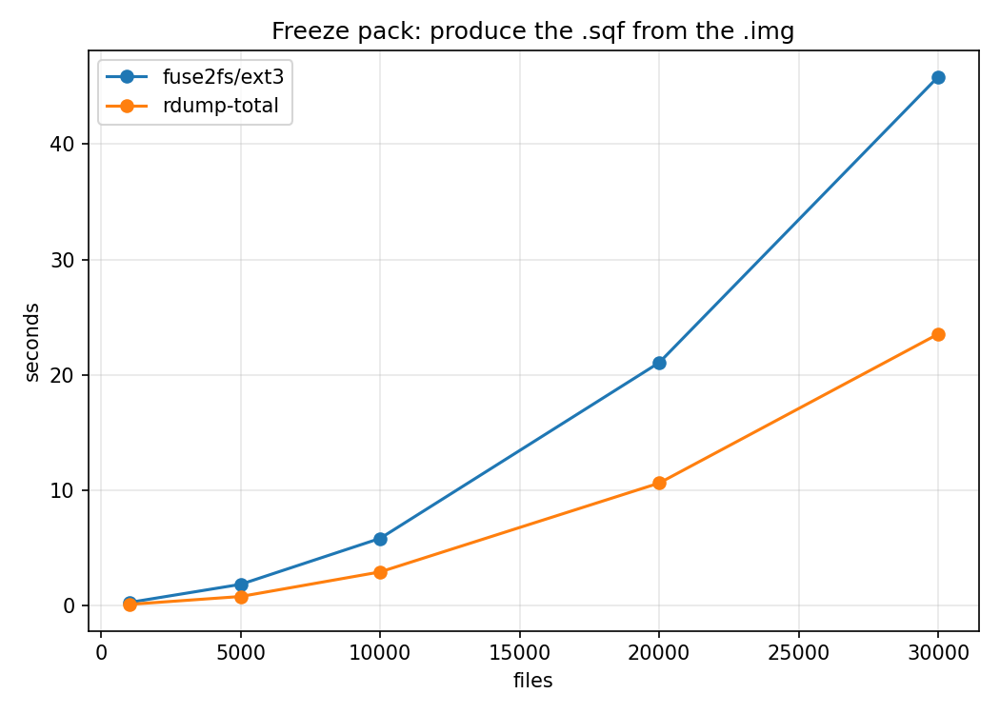
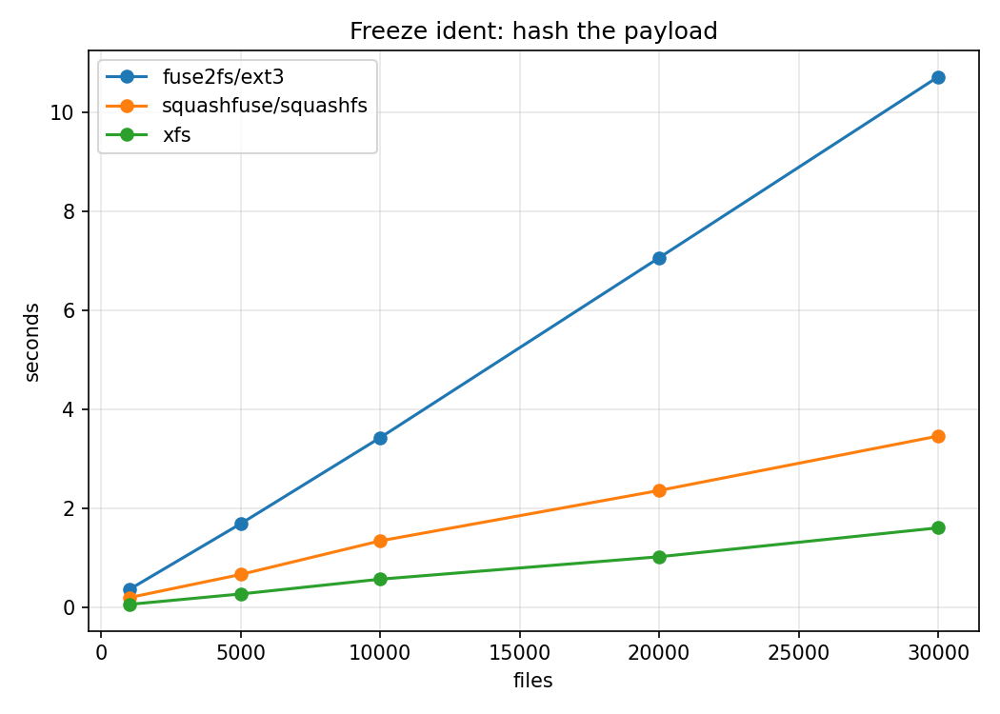

# Freeze: pack and ident route benchmark

Times the parts of a freeze that could be done another way, as file count grows.

- **pack** — produce the `.sqf` from the writable `.img`
  - `fuse` — `mksquashfs` reads through a `fuse2fs` mount of the `.img`
  - `rdump-total` — `debugfs` extracts the payload to a directory, then `mksquashfs` reads
    that directory; the fallback route for when a fuse mount cannot happen
- **ident** — hash the payload, which is what the identity is taken over
  - `img` — through a `fuse2fs` mount of the `.img`
  - `sqf` — through a `squashfuse` mount of the packed `.sqf`
  - `local` — on the plain source directory, no mount at all (speed depends on the file system type)

```
sbatch freeze_bench.sbatch # runs at 4 cores, writes the two CSVs
python3 plot.py            # reads them, writes two png
```

## Results





Run at 1k-30k files, 4 KB each, zstd level 8, 4 processors, on `xfs`-backed local
scratch. Raw data in [pack_bench.csv](pack_bench.csv) and
[ident_bench.csv](ident_bench.csv).

| at 30k files | seconds |
|---|---|
| pack, fuse | 45.8 |
| pack, rdump-total | 23.5 |
| ident, img (fuse2fs/ext3) | 10.7 |
| ident, sqf (squashfuse/squashfs) | 3.5 |
| ident, local (xfs) | 1.6 |

## Other findings

- **Pack is superlinear, ident is linear.** 30k files pack (`fuse`) in 45.8s; 5k in 1.9s.
- **Pack times depend on `-processors`**, so both CSVs record the value used and runs
  at different values are not comparable.
- **`fstype` is recorded per row** because the ident walk is a stat over every inode,
  and that cost is metadata-path performance, which varies by filesystem far more than
  by route.
