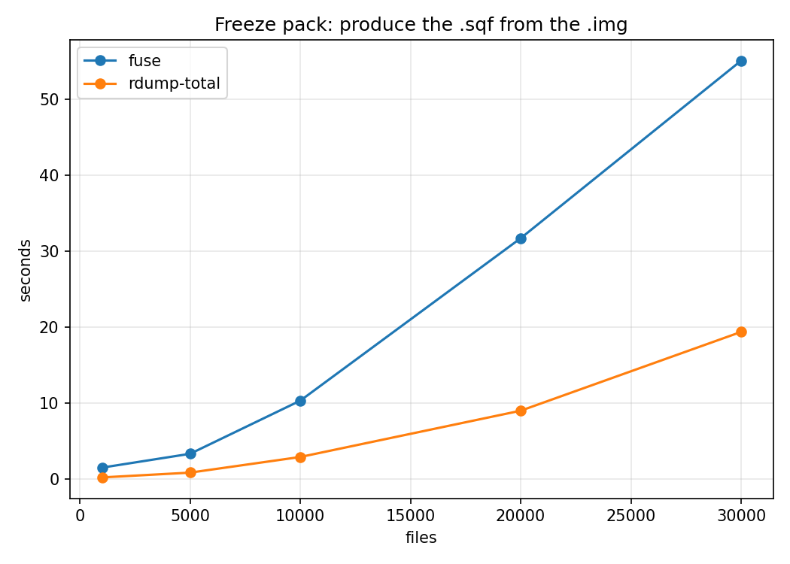
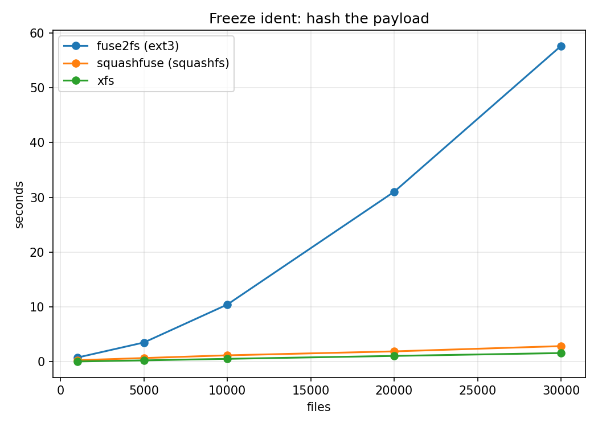

# Freeze bench archive: the bundled `fuse2fs` investigation (resolved)

This is the pre-cleanup snapshot of `../`, from when the main benchmark still
carried a full route matrix. `../freeze_bench.sh` has since been trimmed to
the one route production code actually uses; this directory keeps the old
data and script for reference.

## Issue observed

`ident, img` — hashing an `.img` through a `fuse2fs` mount — showed an
anomalous 57.6s at 30k files, far above `sqf` (2.9s) and `local` (1.6s) at the
same size. Reading the same `.img` through Apptainer's own bundled `fuse2fs`
was consistently slower than through a separately-installed one: about 7x at
30k files on one machine, about 2.3x at 5k on another.

## What was tested

- **Mount mechanism** — `--fusemount container:` vs `host:` mode, same binary.
- **Thread/lock contention** — forcing `-s` (single-threaded) on both builds
  (`singlethread_fuse2fs.sh`).
- **Syscall volume** — `read`/`pread64` counts and per-call cost, both under
  `strace` (`strace_fuse2fs.sh`) and via `/proc/<pid>/io` directly, to check
  whether `ptrace` itself was distorting the comparison.
- **Static vs dynamic linking** — the same e2fsprogs source built both ways
  (`static-vs-dynamic/`), since `ldd` showed bundled statically links its own
  `libext2fs` while a separately-installed build links the host's.
- **FUSE library major version** — `libfuse3.so.3` vs the older `libfuse.so.2`
  (`ldd` on both binaries).
- **e2fsprogs version** — the same source built at two release tags, both
  statically linked (`version/`).

None of the first four changed the outcome. See `static-vs-dynamic/README.md`
and `version/README.md` for the isolated experiments.

## Conclusion

The cause is **the e2fsprogs version**: the bundled binary is always the
newer release (1.47.4) against whatever a PATH install happens to be (1.47.0
or 1.47.1). Rebuilding the identical source at both versions, link mode held
fixed, reproduces the same ~2.3x gap from the version change alone. e2fsprogs'
own `RELEASE-NOTES` documents a change in that version range to use
`O_DIRECT` for `fuse2fs`'s block-device I/O, bypassing the kernel page cache,
as the most plausible mechanism; the specific commit was never bisected. All
of this was tested on `xfs`-backed local scratch; the gap, or its size, may
not hold on other filesystems.

This needed no production fix: freeze already resolves `fuse2fs`/`squashfuse`
from `PATH`, never from Apptainer's bundle, and already mounts with `host:` —
the fast path throughout this investigation.

